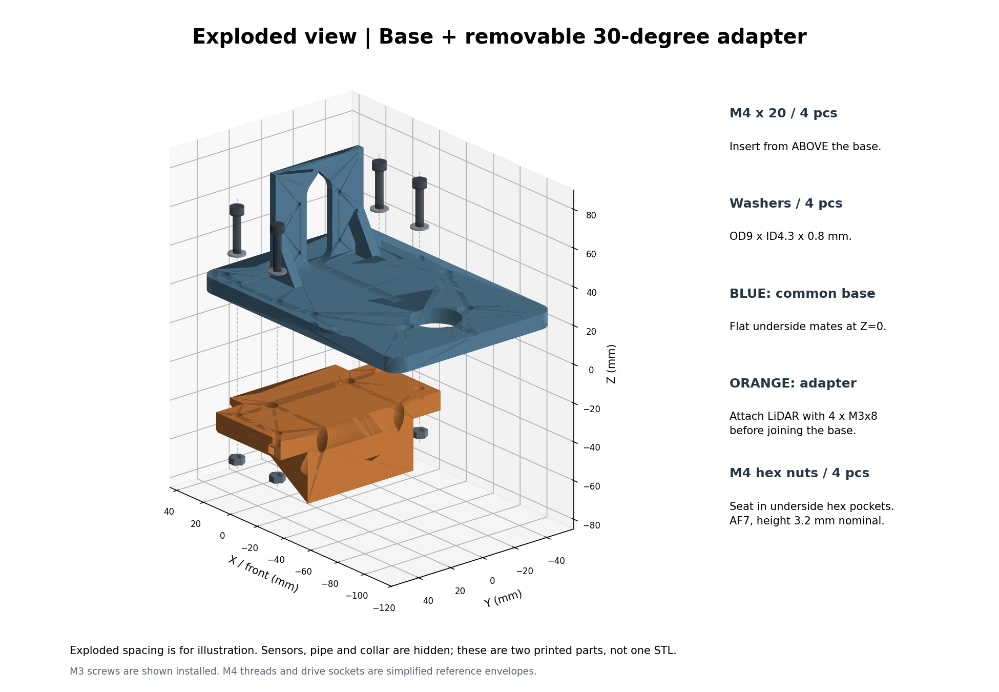
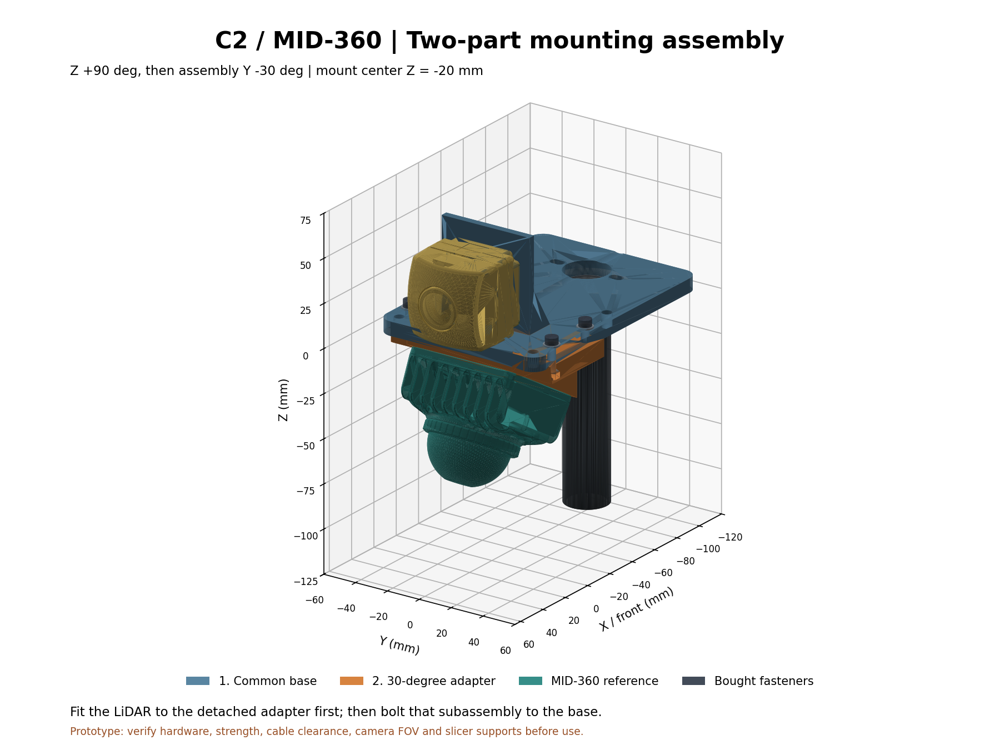
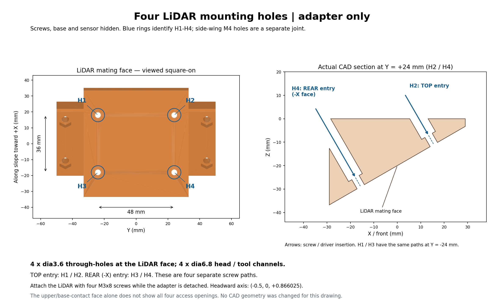

# 分割アセンブリ版 — 共通台座＋30°LiDARアダプター

**印刷する部品は2個です。** 一体型とは別のモデルで、LiDARの姿勢は同じです。組立座標でZ軸+90°、その後Y軸−30°、LiDAR取付面中心は(0, 0, −20) mm。カメラ・パイプの配置も維持しています。

- [共通台座STL](output/split_assembly/base.stl) ×1
- [LiDARアダプターSTL](output/split_assembly/lidar_adapter.stl) ×1
- [組立FreeCAD](output/split_assembly/assembly.FCStd) ／ [組立STEP](output/split_assembly/assembly.step)
- [組立説明PDF](output/split_assembly/assembly_guide.pdf) ／ [検証結果](output/split_assembly/validation.json) ／ [一括ZIP](fixture_assembly_cad.zip)
- 部品単体STEP：[台座](output/split_assembly/base.step) ／ [アダプター](output/split_assembly/lidar_adapter.step)



## LiDARはどう取り付けるか

**先にLiDARをアダプターへ取り付け、それからアダプターごと台座へ固定します。** 台座を付けたままLiDAR用の斜めねじを締める構造ではありません。

1. 台座とアダプターを各1個印刷します。斜め穴・ナットポケットのサポートとバリを除去し、ナットを試しに入れて収まりを確認します。
2. **アダプターを台座から離した状態で**、LiDARを30°の傾斜面に合わせます。アダプター上側・後側から斜めのアクセス穴へM3×8を4本入れ、LiDARへ締結します。細長い六角ドライバー等を使います。
3. アダプター側翼の**下面にある六角ポケットへM4ナット4個**を入れます。ねじが掛かるまでは手・ピンセット等で保持してください。ポケットは回り止め用で、ナットの脱落防止機構ではありません。
4. LiDAR付きアダプターを下から台座へ合わせ、**台座上側からM4×20＋ワッシャーを4組**入れてナットへ締めます。均等に締め、PLAを潰すほどの締付けは避けます。締付トルクの検証は未実施です。
5. カメラを台座へ載せ、M1.6×8を背面から4本取り付けます。カラー・パイプ・配線は[共通の説明](README.md)に従って組み付けます。

交換時はM4を外し、LiDARとアダプターを一式で取り外します。LiDAR単体を交換する際は、その後にM3を外します。組立後は台座がM3のアクセス穴をふさぎますが、M3のねじ頭は台座と干渉しません。



## 4つのLiDAR固定穴とねじの入口

**LiDARに接する傾斜面には4穴ありますが、ねじ・工具の入口は同じ面に4つ並んでいません。** 前側2本（H1・H2）はアダプター上面から、後側2本（H3・H4）は背面（−X側）から斜めに入れます。上面だけを見ても、4つの入口は見えません。



左図は、センサー・ねじ・台座を非表示にして、**LiDAR取付面を正面から見た図**です。青い囲みのH1〜H4がLiDAR用φ3.6穴で、左右の側翼にあるM4穴とは別です。右図は実際のSTEPをY=+24 mmで切った断面で、H2とH4のねじ・工具経路を示します。Y=−24 mmにあるH1とH3も同じ断面形状です。

| 固定穴 | LiDAR側の穴中心 (X, Y, Z) mm | ねじ・工具を入れる面 | 入口中心 (X, Y, Z) mm |
|---|---|---|---|
| H1 | (+15.588, −24, −11) | 上面 | (+9.238, −24, 0) |
| H2 | (+15.588, +24, −11) | 上面 | (+9.238, +24, 0) |
| H3 | (−15.588, −24, −29) | 背面（−X） | (−29, −24, −5.771) |
| H4 | (−15.588, +24, −29) | 背面（−X） | (−29, +24, −5.771) |

同じ詳細図を[組立説明PDF](output/split_assembly/assembly_guide.pdf)の**3ページ目**に追加しています。出力済みSTEPで4穴の貫通とM3ねじ頭・工具の通路を再確認した結果は [hole_access_validation.json](output/split_assembly/hole_access_validation.json) にあります。

## 追加する締結部品

| 用途 | 部品 | 数量 | 備考 |
|---|---|---:|---|
| アダプター→台座 | M4×20 六角穴付きボルト | 4 | 頭径7・高さ4 mmの包絡形状で確認 |
| 同上 | M4平ワッシャー | 4 | 外径9・内径4.3・厚さ0.8 mm想定、台座上面 |
| 同上 | M4六角ナット | 4 | 二面幅7・厚さ3.2 mm想定、アダプター下面ポケット |
| LiDAR→アダプター | M3×8 | 4 | ねじ頭径5.5・高さ3 mm想定、センサー挿入3.5 mm |
| カメラ→台座 | M1.6×8 | 4 | 既存指定、カメラ挿入約4 mm |

部品表は [cad/bom_assembly.csv](cad/bom_assembly.csv)。カラー・パイプ等は別途必要です。実際に使うねじ頭・ナット・ワッシャーの寸法がこの想定と合うことを確認してください。**LiDARのねじ規格と許容ねじ込み深さ、カメラの許容ねじ込み深さはメーカー資料・実機で要確認**です。

## 寸法と接合部

- 共通台座：145 × 100 × 62 mm。台座板厚8 mm、下面Z=0。
- アダプター：58 × 100 × 約36.743 mm。上面Z=0が台座との接触面です。左右の側翼で台座へ固定します。
- 組立した印刷部品の外形：145 × 100 × 約98.743 mm。Z範囲−36.743〜62 mm。
- M4穴：φ4.5 mm、鉛直方向。XY=(-20, ±44.5)、(10, ±44.5) mmの4箇所。既存のホスト取付穴とは別です。
- 側翼の締結位置の厚さ10 mm。下面六角ポケットは二面幅7.4 × 深さ3.5 mm。ポケット上には厚さ6.5 mmの材料が残り、ナットがここを押さえます。
- M4ナット座面Z=−6.5 mm、ナット下面Z=−9.7 mm。M4×20の先端はZ=−11.2 mmで、ナットから約1.5 mm出ます。
- ワッシャーとナットが当たる面、工具経路、実センサーとの非干渉をCADで検証しています。ポケットの片側0.2 mmの隙間は造形開始値で、実プリンタに合わせた調整は必要です。

LiDAR用の4穴は一体型と同じです。穴中心は(X,Y,Z)=(+15.588457, ±24, −11)、(−15.588457, ±24, −29) mm。φ3.6通し穴、φ6.8のねじ頭・工具アクセス穴、軸方向の座厚4.5 mm。ねじ頭側への軸方向は(-0.5, 0, +0.866025)です。

## 印刷用STLと組立座標の違い

**2つのSTLをそれぞれ1個ずつ印刷してください。** `assembly.step` にはセンサー・購入金具も含まれるため、印刷対象ではありません。

- `base.stl`：台座下面がZ=0。そのまま平らな面をベッドへ置きます。
- `lidar_adapter.stl`：組立姿勢からX軸回り180°回転済みです。台座に接する広い平面が下向きになり、最低点Z=0で出力されます。さらに裏返す必要はありません。
- `.step` と `.FCStd` は組立座標を維持しています。STL同士を読み込んで位置合わせする代わりに `assembly.step` を使ってください。
- FreeCADで印刷部品は `PrintableBase` と `LiDARAdapter`。M4ボルト・ワッシャー・ナット・M3ねじは購入品の概略形状で、ねじ山・工具穴は省略しています。

PLA、ノズル0.4 mm、積層0.2 mm、外周5周、上下面6層、Gyroid 40%、ブリム5 mmを開始値とします。斜めアクセス穴、下面の六角ポケット、カメラ開口のオーバーハングをスライサーで確認し、必要なサポートを設定・除去してください。スライス検証・G-code生成は未実施です。

## 検証と制約

生成時に、2部品がそれぞれ単一の有効ソリッドであること、各STLが閉じた連結成分1個であること、両STLの最低点がZ=0であること、STEP再読込で体積が保存されること、FreeCADの再読込・背面板厚編集・復元を確認します。

加えて、印刷部品同士の重なりゼロ、センサーとの干渉ゼロ、実STEPのLiDAR4穴の一致、台座とアダプターの接触、M3ねじ頭の収納、M4金具の非干渉・座面支持・工具経路・下面からのナット挿入、LiDAR付きアダプターを下から取り付ける8段階の経路を検証します。詳細値は [validation.json](output/split_assembly/validation.json) を参照してください。

設計は試作です。金具の実寸・組立公差・締付トルク・強度・PLAのクリープと振動耐久は未検証です。傾けたLiDARのカメラ画像への映り込み、実プラグと配線の取り回しも実機確認が必要です。パイプ外径25 mmやSCS2512CN2取付寸法は従来同様に暫定です。

## 再生成

```bash
cd /workspace/try_astra_cad
FREECAD_PYTHON=/usr/bin/python3 python cad/build.py --variant split
```

出力先は `output/split_assembly/` と `fixture_assembly_cad.zip`。一体型の生成物は上書きしません。図面のみ更新する場合は `python cad/build.py --variant split --render-only`（同じパラメーターと形状コードで生成したキャッシュが必要）。

寸法は `cad/parameters.json` の `lidar`、接合部は `assembly_joint`、印刷説明は `assembly_printing` で指定します。接合部・傾斜部は寸法表のライブ編集対象ではありません。台座厚も金具の位置・長さに影響するため、これらを変える場合はJSON変更後に再生成してください。一体型は従来どおり `python cad/build.py --variant integrated` で生成できます。
