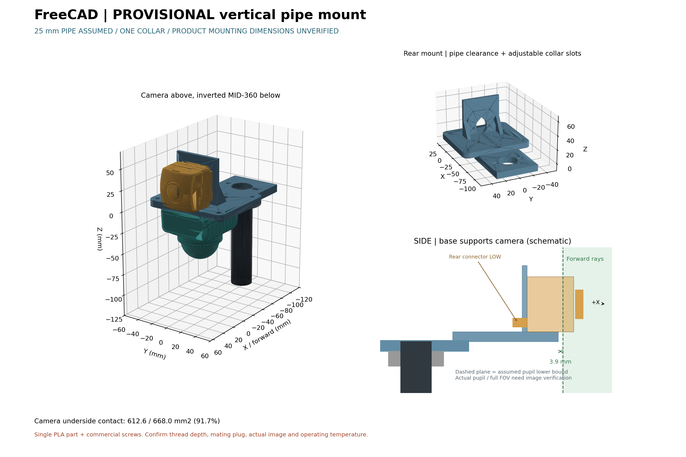

# C2 / MID-360 治具 — 一体型と分割アセンブリ版

**分割アセンブリ版を追加しました。** 共通台座と30°LiDARアダプターを別々に印刷し、M4ボルト4本で組み立てます。LiDARを先にアダプターへ取り付けてから台座へ固定します。

[取付手順・分解図](ASSEMBLY.md) ／ [台座STL](output/split_assembly/base.stl) ／ [アダプターSTL](output/split_assembly/lidar_adapter.stl) ／ [組立FreeCAD](output/split_assembly/assembly.FCStd) ／ [組立STEP](output/split_assembly/assembly.step) ／ [アセンブリ版ZIP](fixture_assembly_cad.zip)

分割版は `python cad/build.py --variant split` で生成します。出力は `output/split_assembly/`。**以下は既存の一体型の説明**で、生成物も残しています。分割版の印刷・金具・組立手順は [ASSEMBLY.md](ASSEMBLY.md) を使ってください。

## 一体型PLA治具 — LiDAR Y軸 −30°取付

一体型：**[STL](output/fixture.stl)** ／ **[STEP](output/fixture.step)** ／ **[FreeCAD](output/fixture.FCStd)** ／ **[図面PDF](output/review_drawing.pdf)** ／ **[一括ZIP](fixture_cad.zip)**。

既存のMID-360のZ軸回り+90°回転を維持したうえで、**組立座標のY軸回りに−30°**傾けました。+Xはカメラ前方、+Zは上です。LiDARの向きは下向きから前方へ30°傾き、走査軸方向は **(+0.5, 0, −0.866025)**、ケーブルは−Y側です。カメラの姿勢・位置、パイプ中心は維持しています。



## 変更した取付部

- 台座下面に傾斜取付部を一体化。印刷部品は引き続き `PrintableFixture` **1個**です。
- 台座は145 × 100 × 8 mm、XY中心=(-41.5, 0)、上面Z=8 mm。傾斜部はXY投影58 × 66 mm。
- LiDAR取付面中心を **(0, 0, −20) mm** に下げ、台座との干渉を避けています。取付平面は `Z = −20 + tan(30°) × X` です。
- 造形部品全体は **145 × 100 × 98.743 mm**、Z範囲は−36.743〜62 mmです。従来の145 × 100 × 62 mmではありません。
- 取付面に直角なφ3.6通し穴4個と、同軸のφ6.8ねじ頭・工具アクセス穴を設けました。ねじ座面も30°傾いています。
- 各ねじ座面からLiDAR取付面までの厚さは軸方向4.5 mm。M3×8は挿入3.5 mmとなる選定案です。メーカーのねじ規格、許容挿入深さ、実ねじ頭寸法を確認してください。

取付面上の穴中心（mm）：

| X | Y | Z |
|---:|---:|---:|
| +15.588457 | −24 | −11 |
| −15.588457 | −24 | −29 |
| +15.588457 | +24 | −11 |
| −15.588457 | +24 | −29 |

穴間隔は傾斜面上で従来の36 × 48 mmを維持しています。ねじ頭側へ向かう穴軸は `(-0.5, 0, +0.866025)` です。穴は鉛直ではありません。LiDARを先に取り付け、深いアクセス穴に沿って工具を入れて締結します。

## 維持している構造

カメラは台座上面で受け、背面4穴で固定します。光軸+X回りの0°と180°のどちらでも取り付けられます。組立モデルでは背面コネクタを下側にした180°の姿勢を表示しています。

- カメラ基準位置X=22 mm、背面接触面X=5.6 mm、下面Z=8 mm。
- 背面板：厚さ4 × 幅55 × 台座上高さ54 mm。背面側に幅5・奥行16・高さ26 mmの補強2個。
- カメラ固定：25 × 25 mmピッチ、Y=±12.5、Z=18 / 43 mm。治具の穴径φ1.8 mm。
- ユーザー指定ねじ：M1.6・頭下約8 mm。ワッシャーなしで挿入約4 mm。実機の許容挿入深さ・頭形状・締付トルクは要確認です。STEPの穴入口径約2.57 mmや軸上の空間だけでは、ねじ規格や許容深さは決まりません。
- ケーブル開口は背面板中央（Y=0）の幅16 mmの縦長穴です。コネクタ中心がZ=15.5 mmと45.5 mmのどちらでもφ16 mm相当の通路を確保しています。開口の下端はZ=7.5 mm、45°屋根の頂点はZ=56.81 mmです。後端X=−114まで深さ最大0.5 mmの逃げがあります。実プラグ寸法は未確認です。
- ホスト取付：XY=(-43, ±42)、(23, ±42)のφ5.7穴4個。

カメラ底面の支持は検証時100%、LiDARの取付面支持は約99.6%です。正確な値は `output/validation.json` を参照してください。

## 縦パイプ固定（暫定寸法）

- パイプ中心はX=−85、Y=0 mm、Z方向。外径25 mmを仮定、逃げ穴φ25.6 mm。上端はZ=0以下に置きます。
- SCS2512CN2を1個、台座下面に取り付ける想定。幅5.5 mmの長穴2個で、対向するボルト中心間34〜40 mmを調整します。製品公称寸法ではありません。
- カラー外径45・幅12・内径25 mm、パイプ内径21 mmは概略包絡形状です。カラーのスリット・締付ねじ・取付ねじ穴・工具空間は再現していません。
- 実物に対応する**軸方向の取付ねじ穴**があること、ねじ径・穴間隔・ねじ込み深さを確認してねじを選定してください。スリット締付ねじを治具固定穴に使いません。
- 1個のカラーによる回り止め・滑り、カーボンパイプの締付耐力、PLA片持ち部の強度は実機確認が必要です。

製品参照：[MISUMI SCS2512CN2](https://jp.misumi-ec.com/vona2/detail/221004989375/?HissuCode=SCS2512CN2)、[カメラ参照指定](https://www.switch-science.com/products/8509)。これらの製品図面は未取得で、センサー形状には付属STEPを使っています。

## 組立と造形

1. スライサーで向きとサポートを設定して造形し、穴・接触面・深い斜めアクセス穴のサポートとバリを除去します。
2. LiDARを傾斜面の法線方向から近づけて座らせ、4本のM3×8を斜めのアクセス穴から取り付けます。カメラ取付前に作業します。
3. 背面コネクタが上側または下側になるようカメラを台座に載せます。前方から後方へ滑らせてコネクタを開口に通し、背面からM1.6×8を4本取り付けます。
4. カラーを台座下面へ取り付け、下からパイプを挿入して固定します。各締付条件はメーカー指定に従ってください。
5. ケーブルを接続し、傾いたLiDAR本体とケーブルを避ける支持構造へ設置します。

**傾斜部がZ=0より下へ張り出すため、従来の「台座下面Z=0をベッドに置く」方法は使えません。** 側面を下にする向き等をスライサーで検討し、サポートを設定してください。開始値はPLA、ノズル0.4 mm、積層0.2 mm、外周5周、上下面6層、Gyroid 40%、ブリム5 mmです。深い斜め穴のサポート除去性も確認してください。プリンタ・スライサーが未指定のため、スライス検証・G-code生成は未実施です。

## 検証と制約

生成スクリプトは次を検証します。

- 単一の有効ソリッド、STLの閉メッシュ・連結成分1個、STEP再読込と体積一致。
- FreeCADファイル再読込、背面板厚+1 mmの再計算と復元。
- 実STEPから取得したLiDARの4穴と斜め穴の一致、取付面支持、4個のねじ座面・ねじ軸・工具経路、8段階の組付け位置。
- 治具とセンサー・パイプ・カラー包絡形状の非干渉。カメラは0°と180°の両方で、底面支持、背面ねじの座面・工具経路、ケーブル経路、8段階の組付け位置を確認します。

治具自体の最前端はX=31 mmで、カメラの仮定視野基準面X=34.9 mmより3.9 mm後方です。ただし、**傾けたLiDAR本体は前方へ張り出します。この治具単体のチェックではLiDARの映り込みは保証できません。** 正確な入射瞳、鉛直・対角視野が不明のため、実機の全画角画像で確認してください。176°は水平視野の仮定値です。

製品適合、実プラグ、LiDARの傾斜運用、PLAの温度・クリープ・強度・振動耐久、カラーとパイプの保持力は未検証の試作設計です。

## 編集と再生成

FreeCAD 1.0以降で `output/fixture.FCStd` を開きます。寸法表 `Parameters` の `CameraX`、`BackT`、`BackW`、`BackH`、`CameraHoleD`、`MountPitch`、`CableD`、`CableZ`、`CableUp`、`BraceW/D/H`、`BaseL/W/T/CX`、`PipeOD/X/Y`、`SlotMin/Max/W` は既存の式参照で編集できます。負の座標は `=-86 mm` のように式として入力してください。

組立モデルに表示するカメラの姿勢は `cad/parameters.json` の `camera.roll_about_forward_deg` で指定します。`0` はコネクタが上側、`180` は下側です。どちらを指定しても両方の姿勢を検証します。

**LiDARの角度・取付中心・傾斜部寸法は `cad/parameters.json` の `lidar` を編集して全体を再生成**してください。`mount_rotation_z_deg` → `mount_rotation_y_deg` の順に組立座標で回転します。角度・参照部品・JSONは寸法表から自動更新されません。現在のスクリプトは−60°より大きく0°より小さいY傾斜を対象とし、寸法や干渉チェックに失敗する変更は出力しません。

```bash
cd /workspace/try_astra_cad
python -m pip install -r requirements.txt
FREECAD_PYTHON=/usr/bin/python3 python cad/build.py
```

FreeCADモジュールはシステムPython、Matplotlib 3.10.8は `python` 側で使用します。CadQueryは使いません。図面のみ更新する場合は `python cad/build.py --render-only`（直前のモデルと一致するキャッシュが必要）。生成は `output/` と `fixture_cad.zip` を更新します。環境検証だけなら作業用コピーで実行してください。既存の隔離済みチェックアウトを使い、追加のGit worktreeは不要です。

`output/latest_print_files.json` に最新版の角度・識別名・SHA256を記録します。`fixture_mid360_z90_5806d96177.*`、`print_7ccf8bb/`、`fixture_integrated_7ccf8bb.zip` は傾斜変更前の保存版で、今回の印刷には使いません。
