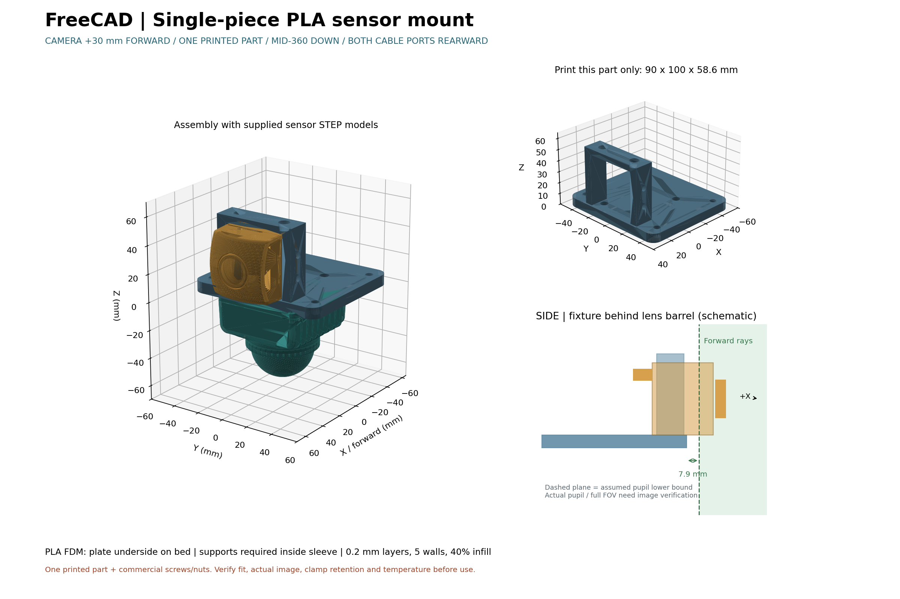

# FreeCAD：C2-176DEG / MID-360 一体型PLA治具

**造形部品は1個**です。FreeCADで作成し、編集用のネイティブFCStdと、治具だけを含むSTLを用意しています。上側のカメラは前向き、下側のMID-360は下向き、ケーブル口は両方とも後方です。カメラを前版より30 mm前へ移しました。



## 使用するファイル

- **`output/fixture.FCStd`**：FreeCADの編集用ドキュメント。寸法表、標準のプリミティブ・結合・切削フィーチャー、実センサー参照形状を含みます。
- **`output/fixture.stl`**：3Dプリントする唯一の部品。単位mm。センサー・ねじ・ナットは含みません。
- `output/fixture.step`：治具だけのSTEP。
- `output/assembly.step`：両センサーを含む確認用組立STEP。これはプリントしません。
- `output/review_drawing.pdf`：寸法表、造形条件、組立手順、視野検証の条件。
- `output/validation.json`：FreeCAD再読込、寸法変更・再計算、単一ソリッド、STL、挿入経路などの検証結果。
- `fixture_cad.zip`：FCStd、STL、STEP、PDF、生成コード、元のセンサーSTEPをまとめた一式。

旧版の別体プレート、支柱、押さえ板、保護パッドの生成ファイルは削除しました。固定ねじ・ナットは市販品を使用します。

## FreeCADでの編集

`fixture.FCStd`をFreeCAD 1.0以降で開いてください。`Parameters`寸法表の値を変更すると、FreeCAD標準の式参照を通じて治具形状が再計算されます。再計算には外部Pythonモジュールを必要としません。

- `CameraX`：カメラと保持枠の前後位置（現在30 mm）。
- `InnerW` / `InnerH`：保持枠の内幅・内高さ（各45.6 mm）。
- `Wall` / `RoofT`：側壁7 mm、上壁5 mm。
- `BaseT`：台座厚8 mm。
- `NutFlat` / `NutDepth`：M4ナット用の二面幅7.3 mm、深さ3.4 mm。

最終造形形状は`PrintableFixture`です。カメラとLiDARの参照形状は、選択してスペースキーで表示を切り替えられます。STLを出力する場合は`PrintableFixture`だけを選択してください。

台座の穴位置、工具穴などには独立した寸法があります。大きく配置を変更する際は、フィーチャーツリーの穴位置も確認してください。FCStd上での編集内容は`parameters.json`に自動で戻りません。スクリプトから再生成する場合は、先に同ファイルを更新してください。

## 配置と視野対策

座標は+Xがカメラ前方、+Zが上です。カメラ下面は台座上面Z=8 mm、逆さにしたLiDARの取付面は台座下面Z=0 mmです。カメラはX=30、Y=0、LiDARはX=0、Y=0に配置しています。

治具の最前部はX=35 mmです。添付STEP上のカメラのレンズ筒付け根を基にした基準面はX=42.9 mmとなり、**治具全体をこの面より7.9 mm後方**に収めています。保持枠はカメラ筐体の後部だけを囲み、レンズ前方へ張り出しません。

視野検証は「光学的な入射瞳がこの基準面以降にある」「視野が前方半球内にある」という条件で行っています。176°は水平視野の仮定値として記載していますが、正確な入射瞳位置、鉛直・対角視野、校正情報は添付STEPにありません。**実機の全画角画像で、治具の映り込みがないことを最終確認してください。**

## 一体部品の構造

- 台座：90 × 100 × 8 mm、角R8。造形全体は90 × 100 × 58.6 mm。
- カメラ保持枠：台座と一体。内寸45.6 × 45.6 mm、前後長17 mm、側壁7 mm、上壁5 mm。
- カメラは前側から、後ろのコネクタを先にして差し込みます。
- +Y側の内面にM4六角ナットを2個収納。外側から**先端がナイロン等の樹脂になったM4ねじ**2本でカメラ側面を押さえます。通常の金属先端で筐体を傷つけないよう、部品を選定してください。
- ナット溝は二面幅7.3 mm、深さ3.4 mm。ねじの通し穴はφ4.6 mm。
- LiDARは48 × 36 mmピッチの4穴で固定。通し穴φ3.6 mm、上面座ぐりφ6.8 × 深さ3.5 mm。
- 前側のLiDARねじには、保持枠の上壁に開けたφ8 mmの工具穴からアクセスします。

カメラの底にはパッドを敷きません。ねじを緩めた状態では、カメラ外形に対して横方向は片側約0.3 mm、上側は約0.6 mmの隙間があります。造形誤差に応じて寸法表で調整してください。

## PLAの造形条件（開始値）

| 項目 | 設定案 |
|---|---|
| ノズル | 0.4 mm |
| 積層ピッチ | 0.2 mm |
| 外周 | 5周 |
| 上下面 | 各6層 |
| インフィル | 40%、Gyroid |
| 向き | 台座の下面Z=0をベッドに置く |
| ブリム | 5 mm |
| サポート | 保持枠の内側上壁に必要。モデル上にも生成する設定 |

保持枠の天井の下は約45.6 mmの空間です。**サポートは「ビルドプレートからのみ」ではなく、台座の上にも生成できる設定**にしてください。前後が開いているため、造形後はそこからサポートを除去できます。除去後、内面、ねじ穴、ナット溝のバリを取ってください。

温度・速度・冷却は、使用するPLAとプリンタのプロファイルに合わせてください。機種が未指定のためG-codeは作成していません。造形時間と実際の材料量はスライサーで確認してください。

## 組立順序と市販部品

1. サポートを完全に除去し、保持枠の内側からM4ナット2個を入れます。クランプねじの先端は内側に出ない位置まで戻しておきます。
2. 台座下面に下向きのMID-360を当て、上面から4本のねじで固定。前側の2本は上壁の工具穴を通して作業します。
3. カメラを前方から差し込み、後部が保持枠に収まる位置に合わせます。樹脂先端のM4ねじ2本で保持します。M4×12は選定の開始値で、実際の先端形状と突出量を確認してください。
4. 設置先にはXY=(-43, ±42)、(23, ±42)のφ5.7穴を使用。設置先は下向きのLiDAR、後方のコネクタ・ケーブルを避けて支持してください。

LiDAR固定ねじはM3相当をSTEP形状から推定しています。M3×8の場合、座ぐり後の台座厚4.5 mmに対して挿入深さは3.5 mmとなります。**実機のねじ規格と許容挿入深さを確認して選定してください。**

PLAは通電したセンサー周辺の温度や締付力によって変形・クリープする可能性があるため、本設計は試作として扱い、実機の温度・保持力・振動を確認してください。筐体の許容面圧が未確認のため締付トルクは指定していません。

## 検証と再生成

FreeCADで、単一の有効ソリッド、センサーとの体積干渉、カメラの前方からの挿入経路、LiDAR固定ねじへの工具アクセス、視野基準面に対する後方余裕を検証しています。STL再読込後の閉じた形状・連結成分1個、STEP再読込、FCStd再読込と上壁厚+1 mmの寸法変更・復元も確認します。物理的な強度試験や実機撮像試験は別途必要です。

必要なもの：FreeCAD 1.0以降とそのPythonモジュール、図面作成用Matplotlib。CadQueryは使用していません。この環境ではFreeCADモジュールを読み込める`/usr/bin/python3`を使っています。

```bash
cd /workspace/try_astra_cad
python -m pip install -r requirements.txt
python cad/build.py
```

別環境では`FREECAD_PYTHON`でFreeCADモジュールを読み込めるPythonを指定できます。FreeCADのライブラリ探索パスは`cad/freecad_build.py`の冒頭に記載しています。主要なモデル寸法は`cad/parameters.json`で指定します。

形状の生成は`cad/freecad_build.py`、図面・ZIP作成は`cad/build.py`です。図面だけを更新する場合は`python cad/build.py --render-only`を使えます。形状コード・パラメータが変わっている場合は再生成が必要です。

既存の隔離済みチェックアウトを使用し、追加のGit worktreeは必要ありません。
